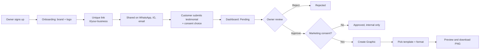

<div align="center">

# ProofCard

### Turn customer love into beautiful social proof.

Collect testimonials with one link. Approve the ones you love. Download them as branded, ready-to-post graphics.


**Create a link → Collect testimonials → Approve feedback → Generate branded graphics → Download and share**

</div>

---

## Table of Contents

1. [Overview](#1-overview)
2. [MVP Scope](#2-mvp-scope)
3. [How It Works](#3-how-it-works)
4. [Tech Stack](#4-tech-stack)
5. [Getting Started](#5-getting-started)
6. [Routes](#6-routes)
7. [Data Model](#7-data-model)
8. [Security, Privacy and Consent](#8-security-privacy-and-consent)
9. [Feature Specifications](#9-feature-specifications)
10. [Graphic Engine](#10-graphic-engine)
11. [Project Structure](#11-project-structure)
12. [API and Server Actions](#12-api-and-server-actions)
13. [Implementation Plan](#13-implementation-plan)
14. [Testing](#14-testing)
15. [Deployment](#15-deployment)
16. [Definition of Done](#16-definition-of-done)
17. [Roadmap](#17-roadmap)
18. [Instructions for the Coding Agent](#18-instructions-for-the-coding-agent)

---

## 1. Overview

ProofCard is a focused SaaS for small businesses, freelancers, agencies and service providers who know social proof matters but hate the process of getting it.

Today, testimonials are scattered across WhatsApp chats, Instagram DMs and emails. Owners screenshot messages that look inconsistent, or pay a designer to turn each one into a post. Customers forget to reply. Nothing is organised.

ProofCard replaces all of that with one flow:

| Step | What happens |
|---|---|
| **1. Create your link** | Set up your business and brand. Get a unique public link. |
| **2. Collect** | Share the link anywhere. Customers submit a testimonial in about a minute, with no account. |
| **3. Approve** | Review submissions in your dashboard. Approve, reject or delete. |
| **4. Create and share** | Turn approved, permission-cleared testimonials into branded PNGs and publish them. |

### Product principles

- **Simple for owners, effortless for customers.** The customer form is one screen, mobile-first, no signup.
- **The graphic is the hero.** Everything exists to produce a great-looking, correctly sized image.
- **Genuine feedback only.** No AI-written reviews, no rewriting, no fabricated social proof.
- **Consent is a hard gate.** No marketing permission means no public graphic. Ever.
- **Not a CRM.** Resist feature creep. Ship the loop above, and make it excellent.

---

## 2. MVP Scope

### Business owners can

- Sign up, log in, log out and reset their password
- Set up a business profile: name, description, category, logo, brand colors, social handle
- Get and share a unique testimonial link (copy, preview, share)
- View, filter, approve, reject and delete testimonials
- Generate graphics from 3 templates in 3 formats, preview them and download a PNG

### Customers can

- Open a link with no account and see the business's branding
- Write a testimonial, optionally add a name, and choose how it appears
- Explicitly grant (or withhold) permission for marketing use
- Submit and see a confirmation

### Explicitly out of scope for the MVP

AI-generated or AI-rewritten testimonials, video/audio testimonials, auto-posting to social platforms, WhatsApp Business API, email campaigns, CRM features, payments, team members, advanced analytics, custom domains, embeddable widgets, public testimonial walls, scheduling and automated reminders.

> These are good ideas for later. They must not delay the first working product.

---

## 3. How It Works



---

## 4. Tech Stack

| Layer | Choice |
|---|---|
| Framework | Next.js (App Router), TypeScript |
| Styling | Tailwind CSS, shadcn/ui, Lucide icons |
| Backend | Server Actions and Route Handlers |
| Database | Supabase PostgreSQL with Row Level Security |
| Auth | Supabase Auth (email and password) |
| Storage | Supabase Storage (private buckets) |
| Validation | Zod, React Hook Form |
| Image generation | SVG templates rendered to PNG with Sharp |
| Rate limiting | Shared store such as Upstash Redis (see [Section 9.3](#93-public-submission-endpoint)) |
| Testing | Vitest (unit/integration), Playwright (E2E) |
| Hosting | Vercel |

Use current stable, mutually compatible versions. Do not add libraries that duplicate something above.

---

## 5. Getting Started

### Prerequisites

- Node.js (current LTS) and a package manager (npm, pnpm or yarn)
- A [Supabase](https://supabase.com) project
- Git

### Setup

```bash
# 1. Create the app (skip if the repo already contains a Next.js project)
npx create-next-app@latest testimonial-studio
# TypeScript: Yes | ESLint: Yes | Tailwind: Yes | App Router: Yes | src/: Yes | alias: @/*

cd testimonial-studio

# 2. Install dependencies
npm install @supabase/supabase-js @supabase/ssr
npm install zod react-hook-form @hookform/resolvers
npm install sharp lucide-react

# 3. Set up shadcn/ui using its current official instructions
```

### Environment variables

Create `.env.local` (never commit it) and a committed `.env.example` with empty values.

```env
NEXT_PUBLIC_SUPABASE_URL=
NEXT_PUBLIC_SUPABASE_ANON_KEY=
SUPABASE_SERVICE_ROLE_KEY=        # server-only. Never expose to the browser.

NEXT_PUBLIC_APP_URL=http://localhost:3000

# Rate limiting (if using Upstash)
UPSTASH_REDIS_REST_URL=
UPSTASH_REDIS_REST_TOKEN=
```

### Supabase checklist

1. Create the project and copy the URL, anon key and service role key.
2. Enable email/password auth.
3. Set the Site URL and allowed redirect URLs (local and production).
4. Run the migrations in `supabase/migrations/` (`001` schema, `002` RLS, `003` storage).
5. Confirm the `business-logos` and `testimonial-graphics` buckets exist and are **private**.
6. Confirm RLS is **enabled** on every table.

```bash
npm run dev    # http://localhost:3000
```

---

## 6. Routes

| Route | Access | Purpose |
|---|---|---|
| `/` | Public | Landing page |
| `/signup` | Public | Business registration |
| `/login` | Public | Business login |
| `/forgot-password` | Public | Password reset |
| `/onboarding` | Auth | Business setup |
| `/dashboard` | Auth | Overview, stats, share link |
| `/dashboard/testimonials` | Auth | List, filter, manage |
| `/dashboard/testimonials/[id]` | Auth | Testimonial detail |
| `/dashboard/testimonials/[id]/design` | Auth | Graphic generator |
| `/dashboard/settings` | Auth | Business and brand settings |
| `/t/[slug]` | Public | Customer testimonial form |

**Redirect rules**

- Logged in but not onboarded → `/onboarding`
- Logged in and onboarded, visiting `/login` or `/signup` → `/dashboard`
- Logged out, visiting any protected route → `/login`

---

## 7. Data Model

```text
auth.users ─1:1─> profiles ─1:N─> businesses ─1:N─> testimonials ─1:N─> generated_graphics
```

All primary keys are UUIDs. All timestamps are `TIMESTAMPTZ` in UTC.

### `profiles`

| Column | Type | Notes |
|---|---|---|
| `id` | uuid PK | References `auth.users.id` |
| `full_name` | text | |
| `email` | text | |
| `created_at`, `updated_at` | timestamptz | |

### `businesses`

| Column | Type | Notes |
|---|---|---|
| `id` | uuid PK | |
| `owner_id` | uuid FK | References `profiles.id`. One business per owner in the MVP. |
| `name` | text | Required |
| `slug` | text | **Unique**, public identifier |
| `description`, `category` | text | Optional |
| `logo_path` | text | Storage path, never a public URL |
| `primary_color` | text | HEX, validated. Required, has default |
| `secondary_color`, `accent_color` | text | HEX, validated, sensible defaults |
| `social_handle` | text | Optional |
| `onboarding_completed` | boolean | |
| `created_at`, `updated_at` | timestamptz | |

### `testimonials`

| Column | Type | Notes |
|---|---|---|
| `id` | uuid PK | |
| `business_id` | uuid FK | Resolved server-side from slug, never from the client |
| `customer_name` | text | Optional |
| `display_name` | text | Derived at submit time: full name, first name or `Anonymous` |
| `testimonial_text` | text | 20 to 1,000 characters |
| `marketing_consent` | boolean | Default `false` |
| `consented_at` | timestamptz | Set **only** when consent is granted |
| `status` | text | `CHECK (status IN ('pending','approved','rejected'))`, default `pending` |
| `submitted_at`, `updated_at` | timestamptz | |

No email addresses or contact details are collected. Do not store more customer data than this.

### `generated_graphics`

| Column | Type | Notes |
|---|---|---|
| `id` | uuid PK | |
| `testimonial_id`, `business_id` | uuid FK | Graphic must belong to the testimonial's business |
| `template` | text | `minimal`, `bold`, `editorial` |
| `format` | text | `portrait`, `square`, `story` |
| `storage_path` | text | Optional, only if persistence is enabled |
| `created_at` | timestamptz | |

If graphics are generated on demand and not stored, either keep only lightweight metadata or omit this table until persistence ships.

### Recommended indexes

`businesses(owner_id)`, `businesses(slug)`, `testimonials(business_id)`, `testimonials(status)`, `testimonials(submitted_at)`, `generated_graphics(testimonial_id)`

### Row Level Security (mandatory)

| Table | Policy |
|---|---|
| `profiles` | Users read and update **only their own** row |
| `businesses` | Owners read, insert (as themselves), update their own. Delete only through an intentional deletion workflow |
| `testimonials` | Owners read, update status and delete rows for **their** business. The public has **no** read access. Public inserts go through the server endpoint, not direct anon writes |
| `generated_graphics` | Only the owning business can read |
| Storage | Private by default. Owners write only under their own `businesses/{business_id}/...` prefix |

Hiding a button is not security. Enforce ownership in server code **and** in RLS.

---

## 8. Security, Privacy and Consent

This product handles customer-written content. Treat these as requirements, not polish.

**Consent**
- The consent checkbox is separate and **unchecked by default**.
- Store `marketing_consent` and `consented_at`.
- A testimonial without consent may be reviewed internally but can **never** enter graphic generation. Show a clear message, and never bypass this silently:
  > *Marketing permission is required before this testimonial can be turned into a public graphic.*
- Honor the customer's name preference exactly. Never reveal more than they chose.

**Data isolation**
- Every business query checks ownership on the server and is backed by RLS.
- Never use a shared service-role client for user-scoped requests.

**Input safety**
- Validate everything server-side with Zod. Client validation is a convenience only.
- Escape all user text before embedding it in SVG.
- Validate logo type and size on the server. Cap request body sizes.
- Never fetch arbitrary external URLs on the server. Load logos only from trusted Supabase Storage paths (prevents SSRF).

**Integrity**
- Never invent, rewrite or truncate a testimonial. If an owner wants an edited version published, the customer must approve that version first.

**Operational**
- Do not expose raw database errors or stack traces. Log technical detail safely on the server.
- Do not retain IP addresses longer than needed for abuse prevention.
- Deleting a testimonial must also handle its generated graphics per your retention policy.

---

## 9. Feature Specifications

### 9.1 Authentication

Email and password via Supabase Auth: signup, login, logout, password reset, persistent sessions, protected routes via the official `@supabase/ssr` middleware pattern. Profile creation should be a safe database trigger (or an idempotent server workflow) so a failed first attempt is recoverable.

**Accepts when:** logged-out users can't reach protected pages, owners see only their data, errors are clear, reset works.

### 9.2 Onboarding and Settings

| Field | Requirement |
|---|---|
| Business name | Required |
| Primary color | Required, default provided |
| Secondary / accent color | Optional, defaults provided |
| Description, category, social handle | Optional |
| Logo | Optional. PNG, JPG, JPEG or WebP, max 2 MB. Preview before save. Replace or remove. |

- Slug generation: lowercase → hyphenate spaces → strip unsupported characters → check collisions → append a short suffix if needed (e.g. `bright-smiles-studio-a82k`).
- The slug stays stable unless the owner explicitly changes it. Never expose internal IDs in public URLs.
- Onboarding must be **idempotent**: it can't create multiple businesses for one user.
- Branding changes apply to **new** graphics only. Past graphics are unchanged unless regenerated.

### 9.3 Public Submission Page and Endpoint

**Route:** `/t/[slug]`. Lightweight, mobile-first, built for people opening links from WhatsApp.

Content: logo (if any), business name, and the heading **"We'd love to hear about your experience."** with the supporting line *"Your feedback helps us improve and helps others understand what it's like to work with us."*

| Field | Rules |
|---|---|
| Testimonial | Required, trimmed, 20 to 1,000 chars. Label: "Tell us about your experience" |
| Name | Optional, max 80 chars |
| Name display | Full name / first name only (**default**) / anonymous. Shown only when a name is given |
| Consent | Unchecked by default. *"I give [Business Name] permission to use this testimonial in its marketing materials, including social media posts and promotional graphics."* |
| Submit | "Submit Testimonial" |

**States:** idle, submitting, success, validation error, network error, rate limited. Block double-submits. No page reload on success.

**Success copy:** *"Thank you for sharing your experience!"* / *"Your feedback has been sent to the business."*

**Endpoint: `POST /api/testimonials`**

```json
{
  "slug": "bright-smiles-studio-a82k",
  "testimonial_text": "I had a great experience...",
  "customer_name": "Jane Doe",
  "name_display": "first_name",
  "marketing_consent": true,
  "website": ""
}
```

> `name_display` is the customer's *preference* (`full_name | first_name | anonymous`). The server derives the stored `display_name` from it. `website` is the honeypot field and must be empty.

Server steps: parse → validate → resolve business **from slug** (never trust a client business ID) → reject unknown slugs → rate limit → sanitize → insert as `pending` → set `consented_at` only if consent given → return success.

**Spam protection (minimum):** per-source rate limiting returning `429`, honeypot, body size limit, throttling. In-memory counters don't work on serverless because instances don't share memory, so use a shared store (Upstash Redis or similar) in production.

### 9.4 Testimonial Management

**Overview stats:** total, pending, approved, rejected. Compute with count queries, not by loading every row.

**List:** newest first, paginated, filter by All / Pending / Approved / Rejected. Each card shows display name (or Anonymous), excerpt, date, status and a permission indicator.

**Detail:** full text, name and display preference, date, consent status, approval status. Actions: **Approve, Reject, Delete** (delete behind a confirmation dialog).

The UI must visibly distinguish four states:

| State | Graphic eligible? |
|---|---|
| Pending | No |
| Rejected | No |
| Approved, **no** consent | No |
| Approved, **with** consent | **Yes** |

**Empty state:** *"No testimonials yet."* / *"Share your unique link with customers to start collecting feedback."* with a copy-link button.

### 9.5 Landing Page

Polished but secondary to the product. Hero ("Turn customer love into beautiful social proof." with *Get Started* and *See How It Works*), a three-step How It Works, a benefits section (no more chasing testimonials across chats, no manual designing, consistent branded proof, simple submission, ready-to-download images) and a final CTA: *"Start collecting testimonials today."*

---

## 10. Graphic Engine

This is the product's differentiator. **Never screenshot the dashboard.** Build a dedicated renderer.

### Formats

| Format | Size | Use |
|---|---|---|
| `portrait` (default) | 1080 × 1350 | Instagram feed |
| `square` | 1080 × 1080 | General social |
| `story` | 1080 × 1920 | Stories, WhatsApp Status |

### Templates

Three **structurally distinct** layouts, not three color swaps.

| Template | Direction |
|---|---|
| **Minimal** | Clean background, large type, small quote mark, logo and name at the bottom, generous whitespace |
| **Bold** | Heavy use of the primary color, large type, distinctive quote mark, high-contrast text areas, branding at the bottom |
| **Editorial** | Elegant layout, neutral background, refined typography, small brand accent, all focus on the words |

Every graphic includes: logo (if any), testimonial text, customer name (only if consent and preference allow), a decorative quote mark, business name, optional social handle and an optional subtle accent.

Never include: internal IDs, emails or private data, unapproved testimonials, or customer photos.

### Pipeline

```text
Authenticated request ─> load testimonial + branding from DB ─> verify ownership,
status = approved, consent = true ─> render SVG string ─> Sharp ─> PNG buffer ─> download
```

```ts
type GraphicFormat = "portrait" | "square" | "story";
type GraphicTemplate = "minimal" | "bold" | "editorial";

type GraphicInput = {
  businessName: string;
  logoUrl?: string;            // resolved from trusted storage, never user-supplied
  primaryColor: string;
  secondaryColor: string;
  accentColor?: string;
  socialHandle?: string;
  testimonialText: string;
  customerDisplayName?: string;
  template: GraphicTemplate;
  format: GraphicFormat;
};

export const GRAPHIC_FORMATS = {
  portrait: { width: 1080, height: 1350 },
  square:   { width: 1080, height: 1080 },
  story:    { width: 1080, height: 1920 },
} as const;
```

Each template exports `(input: GraphicInput) => string` (an SVG string).

### Engineering notes (read these, they bite)

- **SVG has no automatic text wrapping.** Wrap in code: measure with the font's real metrics, compute line height, fit within a safe content box, and step the font size down for long text.
- **Never overflow, never silently truncate.** If text can't fit even at the minimum size, return a clear validation error suggesting another format. Do not clip or rewrite.
- **Fonts must be bundled.** Server-side rendering (librsvg via Sharp) can't rely on system fonts in production. Ship licensed font files with the app and verify rendering **on Vercel**, not just locally. If font rendering proves unreliable there, evaluate an alternative renderer, but document the deviation.
- **Escape all user text** before it enters the SVG (`& < > " '`).
- **Logos:** fetch from Supabase Storage using trusted paths, then embed as a data URI. Handle the no-logo case gracefully.
- **Source of truth is the database.** Never accept branding or testimonial text from the request body.
- **Preview must match export.** Generate the preview from the same server renderer so what the owner sees is what they download.
- **Verify the output:** assert the PNG's pixel dimensions and open real files from every template and format combination.

### Generator UI

Template selector, format selector, live preview (regenerates on change, with a loading state), and **Download PNG**. The preview scales down on small screens without changing export dimensions. No drag-and-drop editor.

Filename: `{business-slug}-testimonial-{YYYY-MM-DD}.png` (e.g. `bright-smiles-testimonial-2026-11-04.png`).

```http
Content-Type: image/png
Content-Disposition: attachment; filename="bright-smiles-testimonial-2026-11-04.png"
```

Copy: *"Turn this feedback into something worth sharing."* and on download, *"Your testimonial graphic is ready."*

---

## 11. Project Structure

```text
src/
  app/
    (marketing)/page.tsx
    (auth)/{signup,login,forgot-password}/page.tsx
    (dashboard)/
      onboarding/page.tsx
      dashboard/
        page.tsx
        testimonials/
          page.tsx
          [id]/page.tsx
          [id]/design/page.tsx
        settings/page.tsx
    t/[slug]/
      page.tsx
      success/page.tsx
    api/
      testimonials/route.ts
      graphics/route.ts

  components/
    ui/  layout/  dashboard/  testimonials/  graphics/  forms/

  lib/
    supabase/      client.ts  server.ts  middleware.ts
    validations/   auth.ts  business.ts  testimonial.ts  graphics.ts
    actions/       business.ts  testimonials.ts  graphics.ts
    graphics/
      templates/   minimal.ts  bold.ts  editorial.ts
      render.ts  svg.ts  wrap.ts
    utils/         slug.ts  colors.ts  format.ts  permissions.ts

  types/           database.ts  business.ts  testimonial.ts  graphics.ts

supabase/migrations/
  001_initial_schema.sql
  002_rls_policies.sql
  003_storage_policies.sql

public/            images/  fonts/
```

The structure may be adjusted, but keep a clean separation between **UI, database access, validation, auth, business logic and image generation**. Avoid giant page components.

### Suggested components

- **Auth:** `AuthForm`, `PasswordInput`, `AuthLayout`
- **Dashboard:** `DashboardLayout`, `Sidebar`, `MobileNavigation`, `DashboardHeader`, `StatCard`
- **Business:** `BusinessProfileForm`, `LogoUploader`, `BrandColorPicker`, `TestimonialLinkCard`
- **Testimonials:** `TestimonialCard`, `TestimonialList`, `TestimonialStatusBadge`, `TestimonialDetail`, `TestimonialApprovalActions`, `TestimonialEmptyState`
- **Graphics:** `TemplateSelector`, `FormatSelector`, `GraphicPreview`, `GraphicDownloadButton`, `GraphicGenerationLoader`
- **Public:** `PublicTestimonialPage`, `TestimonialSubmissionForm`, `ConsentCheckbox`, `SubmissionSuccess`

---

## 12. API and Server Actions

| Operation | Responsibility |
|---|---|
| `signUp` / `signIn` / `signOut` | Auth lifecycle |
| `getBusiness` | Fetch the authenticated owner's business |
| `createBusiness` / `updateBusiness` | Create and edit profile and branding |
| `uploadLogo` | Validate and store a logo |
| `getPublicBusinessBySlug` | Minimal public business data for the form |
| `submitTestimonial` | Public, validated, rate-limited intake |
| `getTestimonials` / `getTestimonialById` | Owner-scoped reads |
| `updateTestimonialStatus` | Approve or reject |
| `deleteTestimonial` | Owner-scoped delete |
| `generateGraphic` | Render branded PNG |
| `downloadGraphic` | Authorized PNG download |

Use one consistent return shape:

```ts
type ActionResult<T> =
  | { success: true; data: T }
  | { success: false; error: string };
```

`POST /api/graphics` takes `{ testimonialId, template, format }`. It authenticates, loads the owner's business, loads the testimonial, verifies ownership, `status === "approved"` and `marketing_consent === true`, validates `template` and `format`, then renders and returns the PNG.

---

## 13. Implementation Plan

Build in this order. **Finish and verify each phase before starting the next.**

| Phase | Focus | Done when |
|---|---|---|
| **1. Foundation** | Next.js setup, Supabase clients (browser and server), session middleware, migrations, RLS, storage buckets | App runs locally, talks to Supabase securely, TypeScript compiles, no secrets in the client bundle |
| **2. Authentication** | Signup, login, logout, reset, protected routes, profile creation | Auth is reliable and protected routes redirect correctly |
| **3. Onboarding and branding** | Setup flow, logo upload, color picker, slug generation, settings page | An owner can create and manage a business profile |
| **4. Dashboard shell** | Sidebar and mobile nav, overview stats, link card, loading, empty and error states | Owner can navigate a working dashboard |
| **5. Public collection** | `/t/[slug]`, Zod schema, `POST /api/testimonials`, rate limiting, honeypot, success state | A customer can submit with no account |
| **6. Testimonial management** | Queries, cards, filters, detail, approve, reject, delete, consent rules | Owners can manage feedback safely |
| **7. Graphic engine** | Types, formats, SVG templates, wrapping, logo handling, Sharp, endpoint, preview UI, download, visual QA | Owners can generate and download correct, attractive PNGs |
| **8. End-to-end workflow** | Wire everything together and test with two separate browser sessions (owner and customer) | The full loop works |
| **9. Polish** | Typography, spacing, a11y, focus states, toasts, confirmations, responsive QA | Every page feels premium on every breakpoint |
| **10. QA** | Unit, integration and Playwright tests | Critical journey is automated |
| **11. Deployment** | Production Supabase, Vercel, env vars, auth URLs, production smoke test | Full flow verified in production |

### Design direction

Modern creative SaaS: clean, premium, minimal, friendly and **typography-led**. Strong spacing, subtle borders, designed empty states, one clear primary action per screen. Avoid the generic admin-template look. Test small mobile, large mobile, tablet, laptop and desktop. The public form must be excellent on mobile above all.

---

## 14. Testing

**Priority journey (automate with Playwright):**
Sign up → onboard → get link → public submission → approve → generate graphic → download.

| Area | Cases |
|---|---|
| **Auth** | Signup, existing email, wrong password, login, logout, reset, session persistence, protected routes |
| **Business** | Create, update, logo upload, invalid and oversized logo, color saving, slug uniqueness |
| **Testimonials** | Valid and invalid submissions, no name, with and without consent, duplicate submit, invalid slug, cross-business access attempt |
| **Moderation** | Approve, reject, delete, unauthorized status change, graphic blocked without consent |
| **Graphics** | 3 templates × 3 formats; long and short text; no logo; no name; first-name and anonymous; light and dark brand colors; long business name; **PNG dimensions**; file opens; filename |
| **Security** | Logged-out dashboard access, cross-tenant reads, public DB access, malformed payloads, rate limiting, SVG escaping, unauthorized downloads |

Use unit tests for validation and utilities, integration tests for server operations and RLS, and Playwright for end-to-end flows.

---

## 15. Deployment

1. Create a production Supabase project and apply all migrations.
2. Confirm buckets are private and RLS is on for every table.
3. Set the production Site URL and redirect URLs in Supabase Auth.
4. Push to GitHub and import into Vercel.
5. Add all environment variables (service role key as a **server-only** secret).
6. Deploy and attach the production domain.
7. Smoke test in production: signup, login, public link, logo upload, submission, dashboard update, graphic generation (check fonts), PNG download, storage permissions.

Do not announce the product as ready until the full production workflow has been tested.

---

## 16. Definition of Done

**Owner**
- [ ] Sign up, log in, log out, reset password
- [ ] Create and update business profile, upload logo, pick brand colors
- [ ] Copy testimonial link
- [ ] View stats, view and filter testimonials
- [ ] Approve, reject, delete
- [ ] Generate graphics, choose template and format, preview, download PNG

**Customer**
- [ ] Open a public link and see branding
- [ ] Submit with no account, optionally add a name and display preference
- [ ] Give or withhold marketing consent
- [ ] See a confirmation

**Graphics**
- [ ] Minimal, Bold and Editorial all work
- [ ] Portrait, Square and Story all work
- [ ] Logo and brand colors render correctly
- [ ] Text wraps, never overflows, never silently truncates
- [ ] Downloaded PNG has the right dimensions and opens

**Security**
- [ ] Dashboard protected, business data isolated
- [ ] Testimonials private by default
- [ ] Consent enforced for marketing graphics
- [ ] Public endpoint validated and rate limited
- [ ] Uploads validated, private graphics not enumerable
- [ ] No service-role secret in the browser

---

## 17. Roadmap

**Version 2**
More templates and fonts, deeper branding controls, optional customer photos with explicit photo consent, custom request messages, email notifications, WhatsApp share shortcuts, collection analytics.

**Version 3**
AI-assisted categorisation and caption suggestions, public testimonial pages, embeddable widgets, multiple locations, team accounts, brand kits, subscription plans and payments.

> AI may one day help organise genuine testimonials or draft captions. It must **never** fabricate customer experiences.

---

## 18. Instructions for the Coding Agent

You are implementing ProofCard from this document. Follow these rules throughout.

1. Read this entire README before writing code, then **inspect the existing repo** and don't overwrite working configuration.
2. Follow the phases in order. Complete and verify each before moving on.
3. TypeScript everywhere. Validate all input with Zod. Keep sensitive logic server-side.
4. Enforce ownership in application code **and** RLS.
5. Never bypass consent. Never invent, rewrite or truncate testimonials.
6. Never expose private business data or the service-role key.
7. No mock data standing in for working backend functionality. No dead buttons or forms.
8. Don't build future features. Don't add unnecessary dependencies.
9. Handle loading, empty, success and error states everywhere.
10. Run lint and type checks regularly and fix errors before proceeding.
11. Inspect actual generated PNGs. A 200 response is not proof the generator works.
12. Document any deviation from this spec, with the reason.
13. Never claim a feature is complete until it has been tested.

### Per-phase workflow

| Step | Action |
|---|---|
| **A. Understand** | Read the phase requirements and the relevant existing code |
| **B. Plan** | List the files, components, DB changes and server operations needed |
| **C. Implement** | Write the code |
| **D. Verify** | Run checks and test the behavior manually |
| **E. Report** | State what was built, files changed, tests run and results, and any open issues |

### Final deliverables

Working source code, migration files, Supabase setup instructions, `.env.example`, a fully functional app (public form, dashboard, moderation, three templates, three formats, PNG download), automated tests for critical flows, deployment instructions, and a concise summary of implemented features and known limitations.

---

<div align="center">

**The core experience must stay simple.**
Create a link. Collect testimonials. Approve feedback. Generate branded graphics. Download and share.

*Build that exceptionally well before adding anything else.*

</div>
