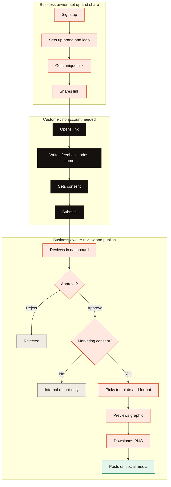
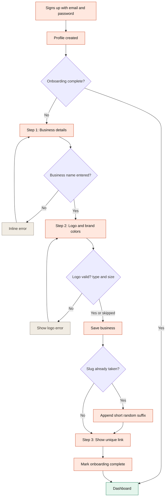
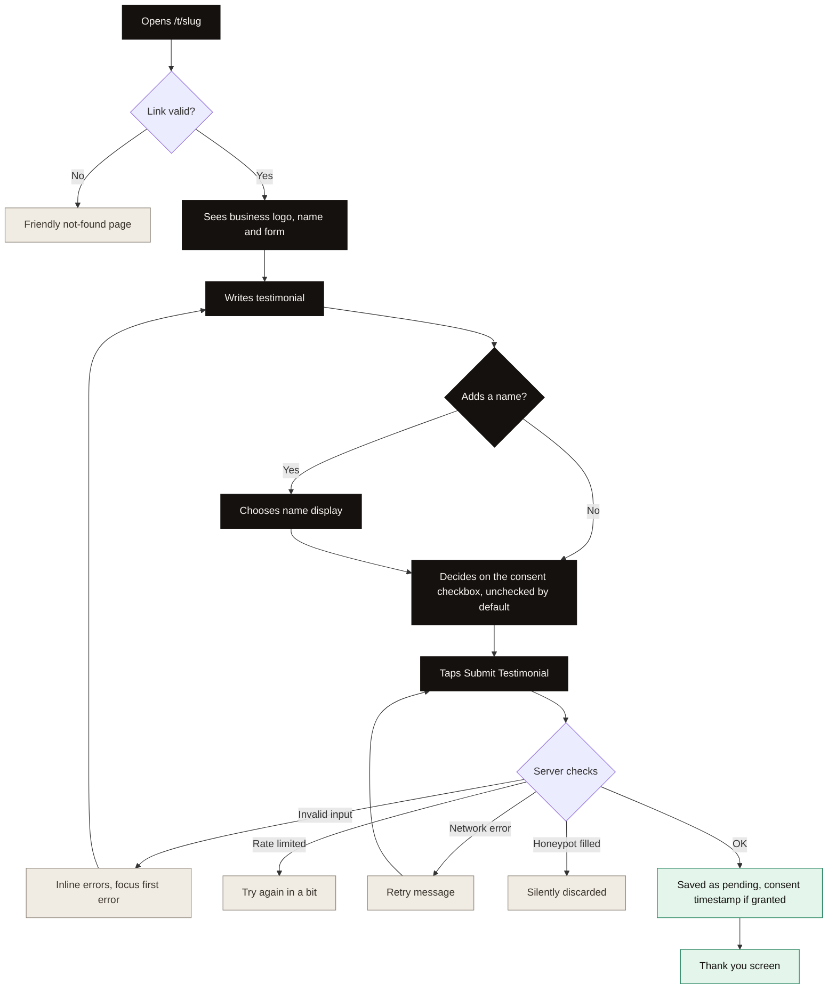
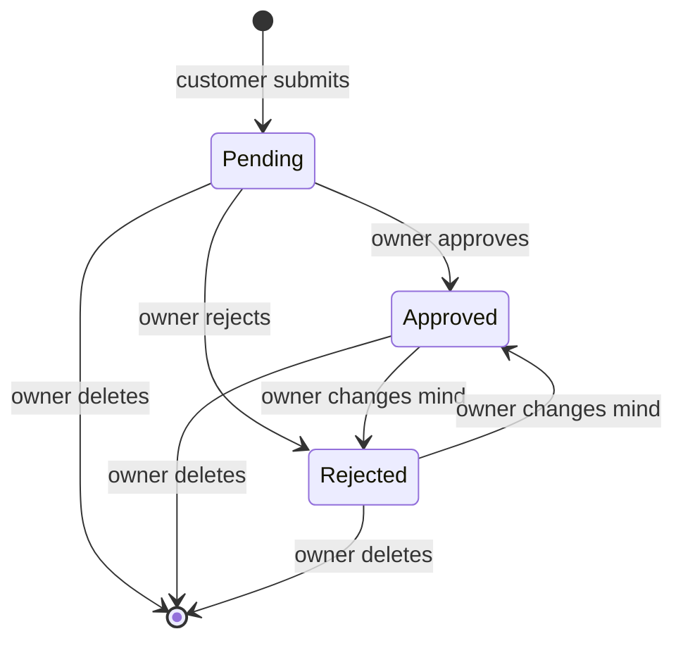
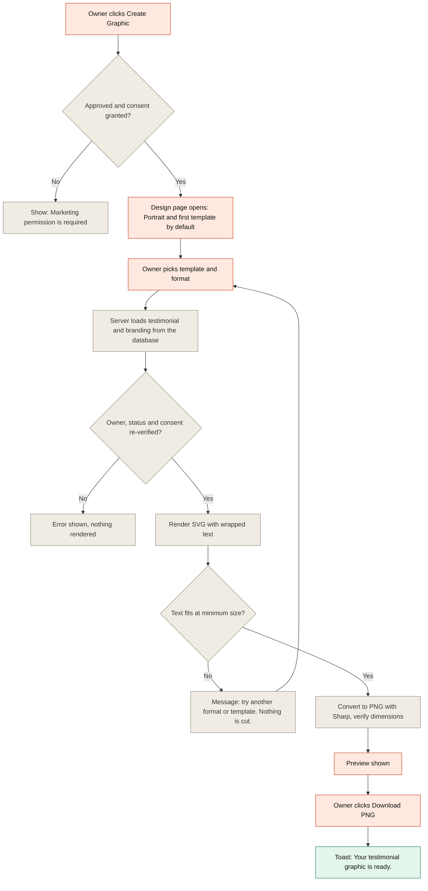
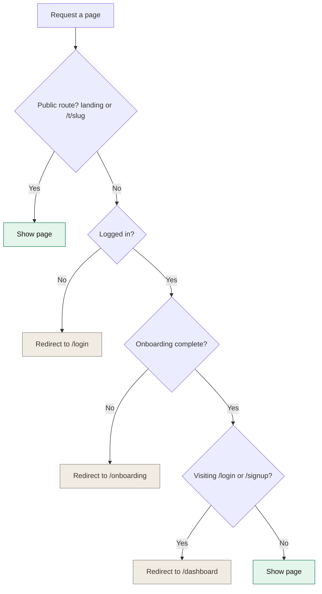
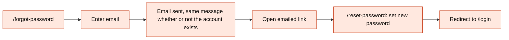
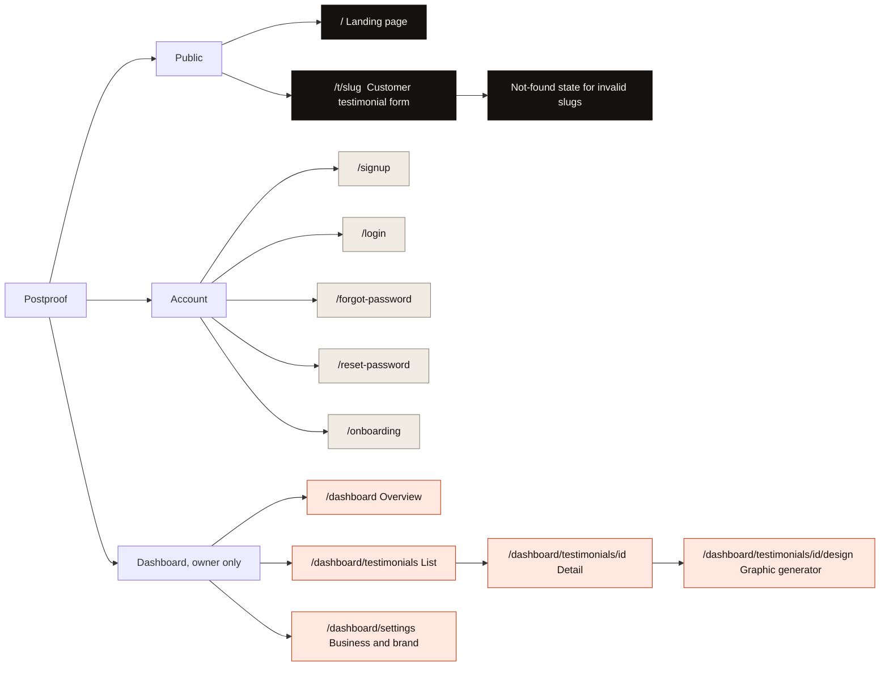
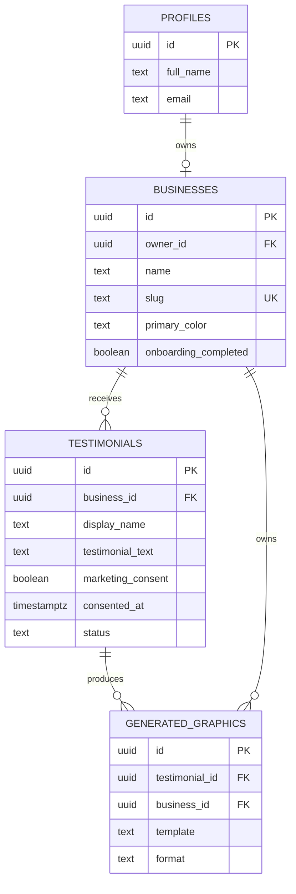

<div align="center">

# Postproof

### Turn customer love into proof worth posting.

Collect customer reviews with one link. Approve the ones you love. Post them as branded graphics.


**Create a link → Collect testimonials → Approve feedback → Generate branded graphics → Download and share**

</div>

---

## Documentation map

This repository has three documents. Read them in this order.

| Document                                               | What it answers                                                                                        |
| ------------------------------------------------------ | ------------------------------------------------------------------------------------------------------ |
| **README.md** (this file)                              | _What_ we are building: product, user flows, information architecture, data, security, build plan      |
| [**STYLE_GUIDE.md**](./STYLE_GUIDE.md)                 | _How it looks and behaves_: colors, type, shadows, motion, every UI component, graphic template design |
| [**LANDING_PAGE_PROMPT.md**](./LANDING_PAGE_PROMPT.md) | _How the marketing page is built_: the creative, interactive landing page specification                |

If this README and the style guide disagree on a visual detail, the style guide wins. If they disagree on product behavior, this README wins.

---

## Table of contents

1. [Overview](#1-overview)
2. [Scope](#2-scope)
3. [Users](#3-users)
4. [User flows](#4-user-flows)
5. [Information architecture](#5-information-architecture)
6. [Tech stack](#6-tech-stack)
7. [Getting started](#7-getting-started)
8. [Data model](#8-data-model)
9. [Security, privacy and consent](#9-security-privacy-and-consent)
10. [Feature specifications](#10-feature-specifications)
11. [Graphic engine](#11-graphic-engine)
12. [Design system summary](#12-design-system-summary)
13. [Project structure](#13-project-structure)
14. [API and server actions](#14-api-and-server-actions)
15. [Implementation plan](#15-implementation-plan)
16. [Testing](#16-testing)
17. [Deployment](#17-deployment)
18. [Definition of done](#18-definition-of-done)
19. [Roadmap](#19-roadmap)
20. [Instructions for the coding agent](#20-instructions-for-the-coding-agent)

---

## 1. Overview

Postproof is a focused SaaS for small businesses, freelancers, agencies and service providers who know social proof matters but dislike the work of getting it.

Today, testimonials end up scattered across WhatsApp chats, Instagram DMs and emails. Owners screenshot messages that look inconsistent, or pay a designer to turn each one into a post. Customers forget to reply. Nothing is organised.

Postproof replaces all of that with one loop:

| Step                    | What happens                                                                    |
| ----------------------- | ------------------------------------------------------------------------------- |
| **1. Create your link** | Set up your business and brand. Get one unique public link.                     |
| **2. Collect**          | Share the link anywhere. Customers submit in about a minute, with no account.   |
| **3. Approve**          | Review submissions in your dashboard. Approve, reject or delete.                |
| **4. Create and share** | Turn approved, permission-cleared testimonials into branded PNGs and post them. |

### Product principles

- **Simple for owners, effortless for customers.** The customer form is one screen, mobile-first, no signup.
- **The graphic is the hero.** Everything exists to produce a great-looking, correctly sized image.
- **Real words only.** No AI-written reviews, no rewriting, no fabricated social proof.
- **Consent is a hard gate.** No marketing permission means no public graphic. Ever.
- **Not a CRM.** Resist feature creep. Ship the loop above, and make it excellent.

### Brand

|                     |                                                                        |
| ------------------- | ---------------------------------------------------------------------- |
| **Name**            | Postproof (one word, capital P)                                        |
| **Tagline**         | Proof worth posting.                                                   |
| **Descriptor**      | Collect customer reviews with one link. Post them as branded graphics. |
| **Primary color**   | Coral `#F2542D`                                                        |
| **Secondary color** | Ink `#14110F`                                                          |

> Before announcing the name publicly, confirm the domain, social handles (X, Instagram) and business-name registration (CAC in Nigeria, plus a trademark search in any other market you sell to).

---

## 2. Scope

### MVP: business owners can

- Sign up, log in, log out and reset their password
- Set up a business profile: name, description, category, logo, brand colors, social handle
- Get and share a unique testimonial link (copy, preview, share)
- View, filter, approve, reject and delete testimonials
- Generate graphics from 3 templates in 3 formats, preview them and download a PNG

### MVP: customers can

- Open a link with no account and see the business's branding
- Write a testimonial, optionally add a name, and choose how it appears
- Explicitly grant (or withhold) permission for marketing use
- Submit and see a confirmation

### Explicitly out of scope for the MVP

AI-generated or AI-rewritten testimonials, video or audio testimonials, auto-posting to social platforms, WhatsApp Business API, email campaigns, CRM features, payments, team members, advanced analytics, star ratings, custom domains, embeddable widgets, public testimonial walls, scheduling and automated reminders.

> These are good ideas for later. They must not delay the first working product.

### Success criteria

The MVP is successful when a business owner can create an account, share a working link, receive a testimonial from a customer's phone, approve it, generate a branded graphic and download a valid PNG, with the file matching the preview, and with **no manual database intervention**.

---

## 3. Users

| User                                     | Description                                                                                                               | Needs                                                                           |
| ---------------------------------------- | ------------------------------------------------------------------------------------------------------------------------- | ------------------------------------------------------------------------------- |
| **Business owner** (primary)             | Clothing stores, beauty businesses, restaurants, online vendors, salons, photographers, event planners, coaches, cleaners | Collect proof without chasing people. Get on-brand graphics without a designer. |
| **Freelancer** (primary)                 | Designers, developers, writers, video editors, marketers                                                                  | Look credible quickly, with consistent branding.                                |
| **Agency or service business** (primary) | Branding, marketing and web agencies, consultancies, studios                                                              | A repeatable way to publish client praise.                                      |
| **Customer** (secondary)                 | Anyone who receives a testimonial link                                                                                    | A fast, friendly form. No account, no clutter, one to two minutes.              |

Customers never see the dashboard. In the MVP they do not download the graphic. The business owner reviews, generates, downloads and publishes it.

---

## 4. User flows

All diagrams use [Mermaid](https://mermaid.js.org/) and render natively on GitHub. Colors follow the brand: **coral tint** boxes are the business owner, **ink** boxes are the customer, **gray** boxes are dead ends or blocked states, **green** is a successful outcome.

### 4.1 The core loop

The whole product in one picture.



### 4.2 Owner: sign up and onboarding



| Detail          | Behavior                                                                                                                               |
| --------------- | -------------------------------------------------------------------------------------------------------------------------------------- |
| Required fields | Business name only. Primary color has a default. Everything else is optional and never blocks progress.                                |
| Steps           | 1 Business, 2 Brand (logo and colors, with a live preview), 3 Your link                                                                |
| Idempotency     | Refreshing or resubmitting must never create a second business for the same user                                                       |
| Slug rules      | Lowercase, hyphens for spaces, unsupported characters removed, collisions get a short suffix (for example `bright-smiles-studio-a82k`) |

### 4.3 Owner: share the link

1. On the dashboard overview, the owner sees their testimonial link in a prominent card.
2. They choose **Copy link**, **Open** (preview as a customer would see it) or **Share** (native share sheet where available).
3. They paste it into WhatsApp, Instagram, email, SMS or anywhere else.

The link stays the same unless the owner explicitly changes it.

### 4.4 Customer: submit a testimonial

This is the flow that must feel effortless. Customers usually open it from WhatsApp on a phone.



| Detail               | Behavior                                                                             |
| -------------------- | ------------------------------------------------------------------------------------ |
| Name display options | Full name, first name only (**default**), anonymous. Shown only once a name is typed |
| Consent              | Separate checkbox, **unchecked by default**. The submission is accepted either way   |
| Duplicate protection | Button disabled and fields read-only while submitting                                |
| Success              | "Thank you for sharing your experience!" with no page reload                         |

### 4.5 Owner: review and moderate

A testimonial moves through three statuses.



**Eligibility for a graphic** depends on two things together:

| Status   | Marketing consent | Can become a graphic?                                    |
| -------- | ----------------- | -------------------------------------------------------- |
| Pending  | Any               | No                                                       |
| Rejected | Any               | No                                                       |
| Approved | **Not granted**   | **No.** Kept as an internal record. The UI explains why. |
| Approved | **Granted**       | **Yes**                                                  |

Owner actions in the dashboard: filter (All, Pending, Approved, Rejected), open a testimonial, **Approve**, **Reject**, **Delete** (always behind a confirmation dialog).

### 4.6 Owner: create and download the graphic



| Detail          | Behavior                                                                                         |
| --------------- | ------------------------------------------------------------------------------------------------ |
| Templates       | Minimal, Bold, Editorial                                                                         |
| Formats         | Portrait 1080×1350 (default), Square 1080×1080, Story 1080×1920                                  |
| Source of truth | The server loads text and branding from the database. The browser never supplies them.           |
| Filename        | `{business-slug}-testimonial-YYYY-MM-DD.png`                                                     |
| Missing pieces  | No logo uses a monogram. No name omits the name line. "Anonymous" is never printed on a graphic. |

### 4.7 Access guard (redirect rules)

Every request passes through this logic.



### 4.8 Supporting flows

**Password reset**



| Flow                     | Steps                                                                                                                                             |
| ------------------------ | ------------------------------------------------------------------------------------------------------------------------------------------------- |
| **Edit branding**        | Settings, change name, logo or colors, **Save changes**. Applies to **new** graphics only. Old graphics are unchanged unless regenerated.         |
| **Delete a testimonial** | Open it, **Delete**, confirm in the dialog. It disappears from the dashboard, and any graphics made from it are handled per the retention policy. |
| **Log out**              | Account menu, **Log out**. Session ends and protected pages redirect to login.                                                                    |
| **Invalid public link**  | `/t/unknown-slug` shows a friendly not-found page and never leaks internal records.                                                               |

---

## 5. Information architecture

### 5.1 Sitemap



### 5.2 Route inventory

| Route                                 | Access                       | Layout      | Purpose                 | Primary content                                                       |
| ------------------------------------- | ---------------------------- | ----------- | ----------------------- | --------------------------------------------------------------------- |
| `/`                                   | Public                       | Marketing   | Explain and convert     | Hero, brand strip, how it works, benefits, product preview, final CTA |
| `/signup`                             | Public (guests only)         | Auth        | Create account          | Email, password, confirm password                                     |
| `/login`                              | Public (guests only)         | Auth        | Sign in                 | Email, password, forgot link                                          |
| `/forgot-password`                    | Public (guests only)         | Auth        | Request reset email     | Email field                                                           |
| `/reset-password`                     | Public (valid reset token)   | Auth        | Set a new password      | New password, confirm                                                 |
| `/onboarding`                         | Authenticated, not onboarded | Stepper     | Create the business     | 3-step setup with live preview                                        |
| `/dashboard`                          | Owner                        | Dashboard   | Overview                | Greeting, link card, 4 stats, recent testimonials                     |
| `/dashboard/testimonials`             | Owner                        | Dashboard   | Manage all feedback     | Filters, testimonial cards, pagination                                |
| `/dashboard/testimonials/[id]`        | Owner                        | Dashboard   | Read and moderate one   | Full text, metadata, Approve, Reject, Delete, Create Graphic          |
| `/dashboard/testimonials/[id]/design` | Owner (eligible only)        | Dashboard   | Make the graphic        | Template and format pickers, preview, Download PNG                    |
| `/dashboard/settings`                 | Owner                        | Dashboard   | Edit business and brand | Details, branding with live preview, link                             |
| `/t/[slug]`                           | Public                       | Public form | Collect testimonials    | Business header, form, consent, success state                         |

**Technical routes (not pages users browse to)**

| Route                    | Purpose                                                                  |
| ------------------------ | ------------------------------------------------------------------------ |
| `POST /api/testimonials` | Public, validated and rate-limited submission endpoint                   |
| `POST /api/graphics`     | Authenticated, authorized graphic generation and PNG download            |
| `/auth/callback`         | Supabase auth redirect handler for email confirmation and password reset |

> **Additions to the original spec:** `/reset-password` and `/auth/callback` are required to complete Supabase password reset and email links. The success view of `/t/[slug]` is shown **inline** with no reload. A separate `/t/[slug]/success` route is optional.

### 5.3 Navigation structure

**Public (landing page)**

| Area    | Items                                                                |
| ------- | -------------------------------------------------------------------- |
| Top nav | Logo, How it works, Why Postproof, Log in, **Get started** (Primary) |
| Footer  | Logo, tagline, Log in, Create account, copyright                     |

**Dashboard**

| Surface                              | Items                                                                                                                          |
| ------------------------------------ | ------------------------------------------------------------------------------------------------------------------------------ |
| **Sidebar** (desktop, 1024px and up) | Business identity (logo, name, "View public page"), **Overview**, **Testimonials** (with pending count), **Settings**, Log out |
| **Bottom navigation** (below 1024px) | Overview, Testimonials, Settings. Pending count badge on Testimonials                                                          |
| **Top header**                       | Page title, contextual actions, account menu (Settings shortcut, Log out)                                                      |
| **Back links**                       | "← Testimonials" on the detail page, "← Testimonial" on the design page                                                        |

**Public testimonial form:** no navigation. A single-purpose page with an optional "Powered by Postproof" footer link.

**Primary actions per page (one per view)**

| Page                           | Primary action     |
| ------------------------------ | ------------------ |
| Landing                        | Get started        |
| Overview                       | Copy link          |
| Testimonials (empty)           | Copy link          |
| Detail (pending)               | Approve            |
| Detail (approved with consent) | Create Graphic     |
| Design                         | Download PNG       |
| Settings                       | Save changes       |
| Public form                    | Submit Testimonial |

### 5.4 Page content hierarchy

Order of content on each key page, top to bottom. This is the reading order and the DOM order.

**Dashboard overview (`/dashboard`)**

1. Greeting: "Welcome back." and "Here's what's happening with your testimonials."
2. **Testimonial link card** (copy, open, share)
3. Stats: Total, Pending, Approved, Rejected
4. Recent testimonials (latest 3) with "View all"

**Testimonials list (`/dashboard/testimonials`)**

1. Page title and short description
2. Filter tabs with counts (All, Pending, Approved, Rejected)
3. Testimonial cards, newest first (name or Anonymous, excerpt, date, status badge, consent badge)
4. Pagination
5. Empty state when there are none: "No testimonials yet." with a Copy link button

**Testimonial detail (`/dashboard/testimonials/[id]`)**

1. Back link
2. Alert if consent is missing: "Marketing permission is required before this testimonial can be turned into a public graphic."
3. Full testimonial text
4. Metadata: customer name, display preference, submitted date, marketing permission, status
5. Actions: Approve, Reject, Delete, then **Create Graphic** once eligible

**Graphic generator (`/dashboard/testimonials/[id]/design`)**

1. Back link and heading: "Turn this feedback into something worth sharing."
2. Preview stage (shows the exact export, scaled to fit)
3. Template selector (Minimal, Bold, Editorial)
4. Format selector (Portrait, Square, Story)
5. Download PNG

**Settings (`/dashboard/settings`)**

1. Business details (name, description, category, social handle)
2. Branding (logo, primary, secondary, accent) with live preview
3. Testimonial link (copy)
4. Save changes (appears when the form has unsaved edits)

**Public form (`/t/[slug]`)**

1. Business logo and name
2. Heading: "We'd love to hear about your experience." and supporting line
3. Testimonial textarea with character counter
4. Name (optional) and name display choice (appears once a name is entered)
5. Consent checkbox tile
6. **Submit Testimonial**
7. Success state replaces the form: "Thank you for sharing your experience!"

### 5.5 Object model and relationships



One owner has one business in the MVP. Enforce this with a unique constraint on `businesses.owner_id`, even though the data model could allow more later.

### 5.6 Who can do what

| Capability                    | Visitor (logged out) | Customer (via link) | Business owner (own data only)  |
| ----------------------------- | -------------------- | ------------------- | ------------------------------- |
| View landing page             | Yes                  | Yes                 | Yes                             |
| Open `/t/[slug]`              | Yes                  | Yes                 | Yes                             |
| Submit a testimonial          | Yes                  | **Yes**             | Yes                             |
| Read any testimonial          | No                   | **No**              | Own business only               |
| Approve, reject, delete       | No                   | No                  | Own business only               |
| Generate or download graphics | No                   | No                  | Own, eligible testimonials only |
| Edit business and brand       | No                   | No                  | Own business only               |
| Access the dashboard          | No                   | No                  | Yes                             |

Enforced in three places: route guards (UX), server-side ownership checks (authority) and Row Level Security (last line of defense).

### 5.7 Labels and vocabulary

Use these words consistently in the UI, code and docs.

| Use                               | Avoid                                   | Notes                                       |
| --------------------------------- | --------------------------------------- | ------------------------------------------- |
| **Testimonial**                   | review, feedback (in headings), comment | "Feedback" is fine in friendly sentences    |
| **Link** or **testimonial link**  | URL, form link                          |                                             |
| **Graphic**                       | image, card, post                       | The downloadable PNG                        |
| **Template**                      | theme, layout, style                    | Minimal, Bold, Editorial                    |
| **Format**                        | size, ratio                             | Portrait, Square, Story                     |
| **Permission** or **consent**     | opt-in, release                         | "Marketing permission" in owner-facing copy |
| **Approve / Reject / Delete**     | Accept, Decline, Remove                 |                                             |
| **Pending / Approved / Rejected** | New, Live, Archived                     |                                             |
| **Business**                      | company, brand, account                 | The thing the owner sets up                 |
| **Owner**                         | admin, user                             | The logged-in person                        |
| **Customer**                      | reviewer, client                        | The person submitting                       |

Sentence case everywhere. Dates read "Nov 5, 2026".

### 5.8 URL and slug conventions

- Public link: `https://{domain}/t/{slug}`. Lowercase, hyphenated, ASCII only.
- Internal IDs (UUIDs) appear only in authenticated dashboard URLs, never in public URLs.
- Slugs are unique, stable and only change when the owner edits them.
- Unknown or deleted slugs resolve to the friendly not-found state with an HTTP 404.

---

## 6. Tech stack

| Layer                 | Choice                                                                       |
| --------------------- | ---------------------------------------------------------------------------- |
| Framework             | Next.js (App Router), TypeScript                                             |
| Styling               | Tailwind CSS, shadcn/ui, Lucide icons                                        |
| Backend               | Server Actions and Route Handlers                                            |
| Database              | Supabase PostgreSQL with Row Level Security                                  |
| Auth                  | Supabase Auth (email and password)                                           |
| Storage               | Supabase Storage (private buckets)                                           |
| Validation            | Zod, React Hook Form                                                         |
| Image generation      | SVG templates rendered to PNG with Sharp                                     |
| Rate limiting         | Shared store such as Upstash Redis                                           |
| Marketing page motion | Motion (formerly Framer Motion), optional Lenis. See the landing page prompt |
| Testing               | Vitest (unit and integration), Playwright (end to end)                       |
| Hosting               | Vercel                                                                       |

Use current stable, mutually compatible versions at implementation time. Do not add libraries that duplicate something above.

---

## 7. Getting started

### Prerequisites

Node.js (current LTS), a package manager, Git, and a [Supabase](https://supabase.com) project.

### Setup

```bash
# 1. Create the app (skip if the repo already has a Next.js project)
npx create-next-app@latest postproof
# TypeScript: Yes | ESLint: Yes | Tailwind: Yes | App Router: Yes | src/: Yes | alias: @/*

cd postproof

# 2. Install dependencies
npm install @supabase/supabase-js @supabase/ssr
npm install zod react-hook-form @hookform/resolvers
npm install sharp lucide-react

# 3. Set up shadcn/ui using its current official instructions
```

### Environment variables

Create `.env.local` (never commit it) and a committed `.env.example` with empty values.

```env
NEXT_PUBLIC_SUPABASE_URL=
NEXT_PUBLIC_SUPABASE_ANON_KEY=
SUPABASE_SERVICE_ROLE_KEY=        # server-only. Never expose to the browser.

NEXT_PUBLIC_APP_URL=http://localhost:3000

# Rate limiting (if using Upstash)
UPSTASH_REDIS_REST_URL=
UPSTASH_REDIS_REST_TOKEN=
```

### Supabase checklist

1. Create the project and copy the URL, anon key and service role key.
2. Enable email and password auth.
3. Set the Site URL and allowed redirect URLs (local and production), including `/auth/callback`.
4. Run the migrations in `supabase/migrations/` (`001` schema, `002` RLS, `003` storage).
5. Confirm the `business-logos` and `testimonial-graphics` buckets exist and are **private**.
6. Confirm RLS is **enabled** on every table.

```bash
npm run dev    # http://localhost:3000
```

---

## 8. Data model

All primary keys are UUIDs. All timestamps are `TIMESTAMPTZ` in UTC.

### `profiles`

| Column                     | Type        | Notes                      |
| -------------------------- | ----------- | -------------------------- |
| `id`                       | uuid PK     | References `auth.users.id` |
| `full_name`                | text        |                            |
| `email`                    | text        |                            |
| `created_at`, `updated_at` | timestamptz |                            |

### `businesses`

| Column                     | Type        | Notes                                           |
| -------------------------- | ----------- | ----------------------------------------------- |
| `id`                       | uuid PK     |                                                 |
| `owner_id`                 | uuid FK     | References `profiles.id`. **Unique** in the MVP |
| `name`                     | text        | Required                                        |
| `slug`                     | text        | **Unique**, public identifier                   |
| `description`, `category`  | text        | Optional                                        |
| `logo_path`                | text        | Storage path, never a public URL                |
| `primary_color`            | text        | HEX validated. Default `#F2542D`                |
| `secondary_color`          | text        | HEX validated. Default `#14110F`                |
| `accent_color`             | text        | HEX validated. Default `#FFD0BE`                |
| `social_handle`            | text        | Optional                                        |
| `onboarding_completed`     | boolean     |                                                 |
| `created_at`, `updated_at` | timestamptz |                                                 |

### `testimonials`

| Column                       | Type        | Notes                                                                    |
| ---------------------------- | ----------- | ------------------------------------------------------------------------ |
| `id`                         | uuid PK     |                                                                          |
| `business_id`                | uuid FK     | Resolved server-side from the slug, never from the client                |
| `customer_name`              | text        | Optional                                                                 |
| `display_name`               | text        | Derived at submit time: full name, first name or `Anonymous`             |
| `testimonial_text`           | text        | 20 to 1,000 characters                                                   |
| `marketing_consent`          | boolean     | Default `false`                                                          |
| `consented_at`               | timestamptz | Set **only** when consent is granted                                     |
| `status`                     | text        | `CHECK (status IN ('pending','approved','rejected'))`, default `pending` |
| `submitted_at`, `updated_at` | timestamptz |                                                                          |

No email addresses or contact details are collected. Store no more customer data than this.

### `generated_graphics`

| Column                          | Type        | Notes                                               |
| ------------------------------- | ----------- | --------------------------------------------------- |
| `id`                            | uuid PK     |                                                     |
| `testimonial_id`, `business_id` | uuid FK     | A graphic must belong to the testimonial's business |
| `template`                      | text        | `minimal`, `bold`, `editorial`                      |
| `format`                        | text        | `portrait`, `square`, `story`                       |
| `storage_path`                  | text        | Optional, only if persistence is enabled            |
| `created_at`                    | timestamptz |                                                     |

If graphics are generated on demand and not stored, keep lightweight metadata or omit this table until persistence ships.

### Indexes

`businesses(owner_id)`, `businesses(slug)`, `testimonials(business_id)`, `testimonials(status)`, `testimonials(submitted_at)`, `generated_graphics(testimonial_id)`

### Row Level Security (mandatory)

| Table                | Policy                                                                                                                                                                           |
| -------------------- | -------------------------------------------------------------------------------------------------------------------------------------------------------------------------------- |
| `profiles`           | Users read and update **only their own** row                                                                                                                                     |
| `businesses`         | Owners read, insert (as themselves) and update their own. Delete only through an intentional deletion workflow                                                                   |
| `testimonials`       | Owners read, update status and delete rows for **their** business. The public has **no** read access. Public inserts go through the server endpoint, not direct anonymous writes |
| `generated_graphics` | Only the owning business can read                                                                                                                                                |
| Storage              | Private by default. Owners write only under their own `businesses/{business_id}/...` prefix                                                                                      |

Hiding a button is not security. Enforce ownership in server code **and** in RLS.

### Storage buckets

| Bucket                 | Purpose                          | Path                                                 |
| ---------------------- | -------------------------------- | ---------------------------------------------------- |
| `business-logos`       | Business logos                   | `businesses/{business_id}/logo/{random_filename}`    |
| `testimonial-graphics` | Generated graphics, if persisted | `businesses/{business_id}/graphics/{graphic_id}.png` |

Validate type and size on upload, never use original filenames as identifiers, and serve private files only through authorized downloads or signed URLs.

---

## 9. Security, privacy and consent

This product handles customer-written content. Treat these as requirements, not polish.

**Consent**

- The consent checkbox is separate and **unchecked by default**.
- Store `marketing_consent` and `consented_at`.
- A testimonial without consent may be reviewed internally but can **never** enter graphic generation. Show a clear message and never bypass it silently.
- Honor the customer's name preference exactly. Never reveal more than they chose.

**Data isolation**

- Every business query checks ownership on the server and is backed by RLS.
- Never use a shared service-role client for user-scoped requests.

**Input safety**

- Validate everything server-side with Zod. Client validation is only a convenience.
- Escape all user text before it enters an SVG.
- Validate logo type and size on the server. Cap request body sizes.
- Never fetch arbitrary external URLs on the server. Load logos only from trusted Supabase Storage paths (prevents SSRF).

**Abuse prevention**

- Public endpoint: rate limiting with HTTP 429, a honeypot field, a body size limit and sensible throttling.
- In production, use a shared rate-limit store. In-memory counters do not work on serverless.
- Do not keep IP addresses longer than abuse prevention needs.

**Integrity**

- Never invent, rewrite or truncate a testimonial. If an owner wants an edited version published, the customer must approve that version first.
- Sample or placeholder testimonials on marketing pages must be clearly labeled as samples, never presented as real customers.

**Operational**

- Do not expose raw database errors or stack traces. Log technical detail safely on the server.
- Deleting a testimonial also handles its generated graphics per the retention policy.

---

## 10. Feature specifications

### 10.1 Authentication

Email and password via Supabase Auth: signup, login, logout, password reset, persistent sessions, protected routes through the official `@supabase/ssr` middleware pattern. Profile creation is a safe database trigger (or an idempotent server workflow) so a failed first attempt is recoverable.

**Accepts when:** logged-out users cannot reach protected pages, owners see only their own data, errors are clear, reset works.

### 10.2 Onboarding and settings

| Field                                | Requirement                                                                        |
| ------------------------------------ | ---------------------------------------------------------------------------------- |
| Business name                        | Required                                                                           |
| Primary color                        | Required, default provided                                                         |
| Secondary and accent color           | Optional, defaults provided                                                        |
| Description, category, social handle | Optional                                                                           |
| Logo                                 | Optional. PNG, JPG, JPEG or WebP, max 2 MB. Preview before save. Replace or remove |

Branding changes apply to **new** graphics only.

### 10.3 Public submission page and endpoint

**Route:** `/t/[slug]`. Lightweight and mobile-first.

| Field        | Rules                                                                                                                                                                  |
| ------------ | ---------------------------------------------------------------------------------------------------------------------------------------------------------------------- |
| Testimonial  | Required, trimmed, 20 to 1,000 characters. Label "Tell us about your experience"                                                                                       |
| Name         | Optional, max 80 characters                                                                                                                                            |
| Name display | Full name, first name only (**default**), anonymous. Shown only when a name is given                                                                                   |
| Consent      | Unchecked by default. _"I give [Business Name] permission to use this testimonial in its marketing materials, including social media posts and promotional graphics."_ |
| Submit       | "Submit Testimonial"                                                                                                                                                   |

**States:** idle, submitting, success, validation error, network error, rate limited.

**Endpoint: `POST /api/testimonials`**

```json
{
  "slug": "bright-smiles-studio-a82k",
  "testimonial_text": "I had a great experience...",
  "customer_name": "Jane Doe",
  "name_display": "first_name",
  "marketing_consent": true,
  "website": ""
}
```

> `name_display` is the customer's **preference** (`full_name`, `first_name` or `anonymous`). The server derives the stored `display_name` from it. `website` is the honeypot field and must be empty.

Server steps: parse, validate, resolve the business **from the slug** (never trust a client business ID), reject unknown slugs, rate limit, sanitize, insert as `pending`, set `consented_at` only if consent was given, return success.

### 10.4 Testimonial management

- **Stats:** total, pending, approved, rejected (use count queries, not a full fetch).
- **List:** newest first, paginated, filterable.
- **Detail:** full text and metadata with Approve, Reject, Delete.
- **Consent rules:** see the eligibility table in [Section 4.5](#45-owner-review-and-moderate).

### 10.5 Landing page

Polished but secondary to the product. Built per [LANDING_PAGE_PROMPT.md](./LANDING_PAGE_PROMPT.md): a creative, interactive, scroll-driven page that uses coral tints and ink together. The headline is "Turn customer love into proof worth posting." Content rules: all sample content is labeled as sample, no real competitor domains, and no claims about features the MVP lacks (such as star ratings or analytics).

### 10.6 Settings

Update business name, description, category, social handle, logo and colors. Copy the testimonial link. Changes affect newly generated graphics only.

---

## 11. Graphic engine

This is the product's differentiator. **Never screenshot the dashboard.** Build a dedicated renderer.

### Formats

| Format               | Size        | Use                      |
| -------------------- | ----------- | ------------------------ |
| `portrait` (default) | 1080 × 1350 | Instagram feed           |
| `square`             | 1080 × 1080 | General social           |
| `story`              | 1080 × 1920 | Stories, WhatsApp Status |

### Templates

Three **structurally distinct** layouts, not three color swaps. Full specifications, including type sizes, safe areas and the automatic text-color rule, are in [STYLE_GUIDE.md, Section 12](./STYLE_GUIDE.md#12-graphic-template-design).

| Template      | Direction                                                                                              |
| ------------- | ------------------------------------------------------------------------------------------------------ |
| **Minimal**   | Clean white background, large type, small quote mark, logo and name at the bottom, generous whitespace |
| **Bold**      | Business primary color full bleed, a content panel, a very large quote mark, high contrast             |
| **Editorial** | Warm neutral background, serif type, thin accent rule, all focus on the words                          |

Every graphic includes: logo (if any), testimonial text, customer name (only if consent and preference allow), a quote mark, business name and the optional social handle. It never includes internal IDs, emails or private data, unapproved testimonials or customer photos.

### Pipeline

```text
Authenticated request → load testimonial + branding from DB → verify ownership,
status = approved, consent = true → render SVG → Sharp → PNG buffer → download
```

```ts
type GraphicFormat = "portrait" | "square" | "story";
type GraphicTemplate = "minimal" | "bold" | "editorial";

type GraphicInput = {
  businessName: string;
  logoUrl?: string; // resolved from trusted storage, never user supplied
  primaryColor: string;
  secondaryColor: string;
  accentColor?: string;
  socialHandle?: string;
  testimonialText: string;
  customerDisplayName?: string;
  template: GraphicTemplate;
  format: GraphicFormat;
};

export const GRAPHIC_FORMATS = {
  portrait: { width: 1080, height: 1350 },
  square: { width: 1080, height: 1080 },
  story: { width: 1080, height: 1920 },
} as const;
```

Each template exports `(input: GraphicInput) => string`, an SVG string.

### Engineering notes (read these, they bite)

- **SVG has no automatic text wrapping.** Wrap in code: measure with real font metrics, compute line height, fit within a safe content box, step the font size down for long text.
- **Never overflow, never silently truncate.** If text cannot fit even at the minimum size, return a clear validation error suggesting another format or template.
- **Some very long testimonials will not fit Square.** The product allows up to 1,000 characters, so this is expected. Show the message, do not cram.
- **Bundle fonts.** Server-side rendering cannot rely on system fonts in production. Ship licensed static font files (not variable fonts) and verify rendering **on Vercel**, not only locally. If it proves unreliable, evaluate another renderer and document the deviation.
- **Escape all user text** before it enters the SVG (`& < > " '`).
- **Logos:** load from Supabase Storage using trusted paths and embed as data URIs. Handle the no-logo case with a monogram.
- **The database is the source of truth.** Never accept branding or testimonial text from the request body.
- **Preview must match export.** Render the preview with the same server renderer.
- **Verify the output.** Assert PNG dimensions and open real files for every template and format combination.

### Generator UI

Template selector, format selector, live preview (regenerates on change with a loading state) and **Download PNG**. The preview scales down on small screens without changing export dimensions. No drag-and-drop editor.

```http
Content-Type: image/png
Content-Disposition: attachment; filename="bright-smiles-testimonial-2026-11-05.png"
```

---

## 12. Design system summary

The full system lives in [STYLE_GUIDE.md](./STYLE_GUIDE.md). The essentials:

### Color

| Token                     | Hex                               | Role                                                                      |
| ------------------------- | --------------------------------- | ------------------------------------------------------------------------- |
| **Coral 500** (primary)   | `#F2542D`                         | Brand color, primary buttons. Always paired with **Ink** text             |
| **Ink** (secondary)       | `#14110F`                         | Text, sidebar, secondary buttons                                          |
| **Paper**                 | `#FAF7F2`                         | Page background                                                           |
| Coral 600                 | `#C93A14`                         | Coral text and links on light backgrounds, focus rings, selected controls |
| Coral 100                 | `#FFE8DF`                         | Tint backgrounds                                                          |
| Muted                     | `#6B645C`                         | Secondary text                                                            |
| Success / Warning / Error | `#157A52` / `#8A5200` / `#B42318` | Status colors, always paired with an icon and label                       |

> White text on Coral 500 is only 3.45:1 and fails contrast for small text. Use **Ink** on coral. If you want white text, the fill must be Coral 600 or darker.

### Type

| Role                       | Font                |
| -------------------------- | ------------------- |
| Headlines                  | Bricolage Grotesque |
| Interface and body         | DM Sans             |
| Links, slugs, hex codes    | JetBrains Mono      |
| Editorial graphic template | Playfair Display    |

### Shape, shadow and motion

10px default radius, warm Ink-tinted shadows in five levels, spring-based quiet motion with full `prefers-reduced-motion` support. Details in the style guide.

### App colors versus business colors

The dashboard always uses Postproof colors. A business's own colors appear **only** on its public form accents and its generated graphics. Never recolor the whole app with a user's brand.

---

## 13. Project structure

```text
src/
  app/
    (marketing)/page.tsx
    (auth)/{signup,login,forgot-password,reset-password}/page.tsx
    (dashboard)/
      onboarding/page.tsx
      dashboard/
        page.tsx
        testimonials/
          page.tsx
          [id]/page.tsx
          [id]/design/page.tsx
        settings/page.tsx
    t/[slug]/page.tsx
    auth/callback/route.ts
    api/
      testimonials/route.ts
      graphics/route.ts

  components/
    ui/  layout/  dashboard/  testimonials/  graphics/  forms/  landing/

  lib/
    supabase/      client.ts  server.ts  middleware.ts
    validations/   auth.ts  business.ts  testimonial.ts  graphics.ts
    actions/       business.ts  testimonials.ts  graphics.ts
    graphics/
      templates/   minimal.ts  bold.ts  editorial.ts
      render.ts  svg.ts  wrap.ts  tokens.ts
    utils/         slug.ts  colors.ts  format.ts  permissions.ts

  types/           database.ts  business.ts  testimonial.ts  graphics.ts

supabase/migrations/
  001_initial_schema.sql
  002_rls_policies.sql
  003_storage_policies.sql

public/            images/  fonts/
```

Keep a clean separation between UI, database access, validation, authentication, business logic and image generation. Avoid giant page components.

**Suggested components** (specifications are in the style guide)

- **Auth:** `AuthForm`, `PasswordInput`, `AuthLayout`
- **Dashboard:** `DashboardLayout`, `Sidebar`, `MobileNavigation`, `DashboardHeader`, `StatCard`
- **Business:** `BusinessProfileForm`, `LogoUploader`, `BrandColorPicker`, `TestimonialLinkCard`
- **Testimonials:** `TestimonialCard`, `TestimonialList`, `TestimonialStatusBadge`, `TestimonialDetail`, `TestimonialApprovalActions`, `TestimonialEmptyState`
- **Graphics:** `TemplateSelector`, `FormatSelector`, `GraphicPreview`, `GraphicDownloadButton`, `GraphicGenerationLoader`
- **Public:** `PublicTestimonialPage`, `TestimonialSubmissionForm`, `ConsentCheckbox`, `SubmissionSuccess`

---

## 14. API and server actions

| Operation                               | Responsibility                            |
| --------------------------------------- | ----------------------------------------- |
| `signUp`, `signIn`, `signOut`           | Auth lifecycle                            |
| `getBusiness`                           | Fetch the authenticated owner's business  |
| `createBusiness`, `updateBusiness`      | Create and edit profile and branding      |
| `uploadLogo`                            | Validate and store a logo                 |
| `getPublicBusinessBySlug`               | Minimal public business data for the form |
| `submitTestimonial`                     | Public, validated, rate-limited intake    |
| `getTestimonials`, `getTestimonialById` | Owner-scoped reads                        |
| `updateTestimonialStatus`               | Approve or reject                         |
| `deleteTestimonial`                     | Owner-scoped delete                       |
| `generateGraphic`                       | Render the branded PNG                    |
| `downloadGraphic`                       | Authorized PNG download                   |

Use one consistent return shape and never expose raw database errors.

```ts
type ActionResult<T> =
  | { success: true; data: T }
  | { success: false; error: string };
```

`POST /api/graphics` takes `{ testimonialId, template, format }`. It authenticates, loads the owner's business and the testimonial, verifies ownership, `status === "approved"` and `marketing_consent === true`, validates `template` and `format`, then renders and returns the PNG.

---

## 15. Implementation plan

Build in this order. **Finish and verify each phase before starting the next.**

| Phase                          | Focus                                                                                                               | Done when                                                                                          |
| ------------------------------ | ------------------------------------------------------------------------------------------------------------------- | -------------------------------------------------------------------------------------------------- |
| **1. Foundation**              | Next.js setup, Supabase clients, session middleware, migrations, RLS, storage buckets                               | App runs locally, talks to Supabase securely, TypeScript compiles, no secrets in the client bundle |
| **2. Authentication**          | Signup, login, logout, reset (including `/reset-password` and `/auth/callback`), protected routes, profile creation | Auth is reliable and the access guard (Section 4.7) works                                          |
| **3. Onboarding and branding** | 3-step setup, logo upload, color picker, slug generation, settings page                                             | An owner can create and manage a business profile                                                  |
| **4. Dashboard shell**         | Sidebar and mobile nav, overview stats, link card, loading, empty and error states                                  | Owner can navigate a working dashboard                                                             |
| **5. Public collection**       | `/t/[slug]`, Zod schema, `POST /api/testimonials`, rate limiting, honeypot, success state                           | A customer can submit with no account                                                              |
| **6. Testimonial management**  | Queries, cards, filters, detail, approve, reject, delete, consent rules                                             | Owners can manage feedback safely                                                                  |
| **7. Graphic engine**          | Types, formats, SVG templates, wrapping, logos, Sharp, endpoint, preview UI, download, visual QA                    | Owners can generate and download correct, attractive PNGs                                          |
| **8. End-to-end workflow**     | Wire everything together and test with two browser sessions (owner and customer)                                    | The full loop in Section 4.1 works                                                                 |
| **9. Polish**                  | Apply the style guide: type, spacing, accessibility, focus states, toasts, responsive QA                            | Every page feels premium on every breakpoint                                                       |
| **10. Landing page**           | Build per the landing page prompt                                                                                   | The marketing page meets its checklist                                                             |
| **11. Testing**                | Unit, integration and Playwright tests                                                                              | The critical journey is automated                                                                  |
| **12. Deployment**             | Production Supabase, Vercel, env vars, auth URLs, production smoke test                                             | Full flow verified in production                                                                   |

---

## 16. Testing

**Priority journey (automate with Playwright):** sign up, onboard, get link, public submission, approve, generate graphic, download.

| Area              | Cases                                                                                                                                                                               |
| ----------------- | ----------------------------------------------------------------------------------------------------------------------------------------------------------------------------------- |
| **Auth**          | Signup, existing email, wrong password, login, logout, reset, session persistence, access guard redirects                                                                           |
| **Business**      | Create, update, logo upload, invalid and oversized logo, color saving, slug uniqueness, no duplicate business on refresh                                                            |
| **Testimonials**  | Valid and invalid submissions, no name, with and without consent, duplicate submit, honeypot, invalid slug, cross-business access attempt                                           |
| **Moderation**    | Approve, reject, delete, status changes both ways, unauthorized status change, graphic blocked without consent                                                                      |
| **Graphics**      | 3 templates × 3 formats, long and short text, no logo, no name, first-name and anonymous, light and dark brand colors, long business name, **PNG dimensions**, file opens, filename |
| **Security**      | Logged-out dashboard access, cross-tenant reads, public database access, malformed payloads, rate limiting, SVG escaping, unauthorized downloads                                    |
| **Accessibility** | Keyboard path through the public form and approve-to-download flow, contrast spot checks, 200% zoom, reduced motion                                                                 |

---

## 17. Deployment

1. Create a production Supabase project and apply all migrations.
2. Confirm buckets are private and RLS is on for every table.
3. Set the production Site URL and redirect URLs (including `/auth/callback`).
4. Push to GitHub and import into Vercel.
5. Add all environment variables (the service role key is a **server-only** secret).
6. Deploy and attach the production domain.
7. Smoke test in production: signup, login, public link, logo upload, submission, dashboard update, graphic generation (check fonts), PNG download, storage permissions.

Do not announce the product as ready until the full production workflow has been tested.

---

## 18. Definition of done

**Owner**

- [ ] Sign up, log in, log out, reset password
- [ ] Create and update the business profile, upload a logo, pick brand colors
- [ ] Copy the testimonial link
- [ ] View stats, view and filter testimonials
- [ ] Approve, reject, delete
- [ ] Generate graphics, choose template and format, preview, download PNG

**Customer**

- [ ] Open a public link and see branding
- [ ] Submit with no account, optionally add a name and display preference
- [ ] Give or withhold marketing consent
- [ ] See a confirmation

**Graphics**

- [ ] Minimal, Bold and Editorial all work
- [ ] Portrait, Square and Story all work
- [ ] Logo and brand colors render correctly
- [ ] Text wraps, never overflows and is never silently truncated
- [ ] Downloaded PNG has the right dimensions and opens

**Security**

- [ ] Dashboard protected and business data isolated
- [ ] Testimonials private by default
- [ ] Consent enforced for marketing graphics
- [ ] Public endpoint validated and rate limited
- [ ] Uploads validated, private graphics not enumerable
- [ ] No service-role secret in the browser

**Architecture**

- [ ] Every route in Section 5.2 exists with the correct access rule
- [ ] Redirect behavior matches the access guard in Section 4.7
- [ ] UI vocabulary matches Section 5.7

---

## 19. Roadmap

**Version 2:** more templates and fonts, deeper branding controls, optional customer photos with explicit photo consent, custom request messages, email notifications, WhatsApp share shortcuts, collection analytics.

**Version 3:** AI-assisted categorisation and caption suggestions, public testimonial pages, embeddable widgets, multiple locations, team accounts, brand kits, subscription plans and payments.

> AI may one day help organise genuine testimonials or draft captions. It must **never** fabricate customer experiences.

---

## 20. Instructions for the coding agent

You are implementing Postproof from this document. Follow these rules throughout.

1. Read this README, `STYLE_GUIDE.md` and (for the marketing page) `LANDING_PAGE_PROMPT.md` before writing code. Then **inspect the existing repo** and do not overwrite working configuration.
2. Follow the phases in order. Complete and verify each before moving on.
3. TypeScript everywhere. Validate all input with Zod. Keep sensitive logic server-side.
4. Enforce ownership in application code **and** RLS.
5. Never bypass consent. Never invent, rewrite or truncate testimonials.
6. Never expose private business data or the service-role key.
7. Use the tokens and component specs in the style guide. Do not invent colors, shadows or radii.
8. Follow the information architecture: exact routes, access rules, navigation and vocabulary from Section 5.
9. No mock data standing in for working backend functionality. No dead buttons or forms.
10. Do not build future features. Do not add unnecessary dependencies.
11. Handle loading, empty, success and error states everywhere.
12. Run lint and type checks regularly and fix errors before proceeding.
13. Inspect actual generated PNGs. A 200 response is not proof the generator works.
14. Document any deviation from this spec, with the reason.
15. Never claim a feature is complete until it has been tested.

### Per-phase workflow

| Step              | Action                                                                          |
| ----------------- | ------------------------------------------------------------------------------- |
| **A. Understand** | Read the phase requirements and the relevant existing code                      |
| **B. Plan**       | List the files, components, DB changes and server operations needed             |
| **C. Implement**  | Write the code                                                                  |
| **D. Verify**     | Run checks and test the behavior manually                                       |
| **E. Report**     | State what was built, files changed, tests run and results, and any open issues |

### Final deliverables

Working source code, migration files, Supabase setup instructions, `.env.example`, a fully functional app (public form, dashboard, moderation, three templates, three formats, PNG download), the landing page, automated tests for critical flows, deployment instructions, and a concise summary of implemented features and known limitations.

---

<div align="center">

**The core experience must stay simple.**
Create a link. Collect testimonials. Approve feedback. Generate branded graphics. Download and share.

_Build that exceptionally well before adding anything else._

</div>
